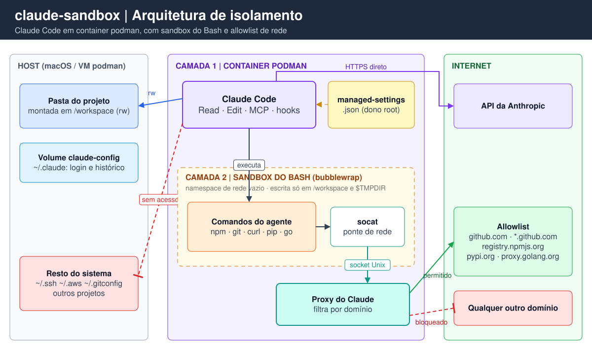

# claude-sandbox

Roda o [Claude Code](https://code.claude.com/docs) dentro de um container podman, com acesso só ao diretório do projeto e rede restrita a uma lista de domínios. A ideia é poder usar `--dangerously-skip-permissions` (sem pedidos de confirmação) sem expor o resto da máquina.

## Arquivos

| Arquivo | O que é |
|---|---|
| `Dockerfile` | Imagem Ubuntu 26.04 com toolchain (C/C++, Python, Node, Go), `bubblewrap`, `socat` e o Claude Code |
| `managed-settings.json` | Política do Claude Code: sandbox do Bash obrigatório, allowlist de rede e proteção de credenciais. Vai para `/etc/claude-code/` na imagem |
| `claude-sandbox` | Script que sobe o container no diretório atual com as flags de segurança |

## Como funciona



<sub>Fonte editável: [`docs/arquitetura.excalidraw`](docs/arquitetura.excalidraw) (abra em [excalidraw.com](https://excalidraw.com)).</sub>

Em resumo: o Claude só enxerga a pasta do projeto, e os comandos que ele roda só conseguem acessar os sites da lista.

São duas camadas de isolamento:

**1. O container** (`claude-sandbox`) — isola o processo inteiro do Claude, incluindo leitura/edição de arquivos, MCP servers e hooks:

- monta **só o diretório atual** em `/workspace`; o script se recusa a rodar em `/`, `$HOME`, `/Users` e `/home`
- usuário não-root (`ubuntu`, uid 1000) mapeado para o seu usuário com `--userns=keep-id`, então os arquivos criados ficam com o seu dono
- `--cap-drop=ALL`, `--security-opt=no-new-privileges`, limites de PIDs, memória e CPU
- nenhuma credencial do host é montada (`~/.ssh`, `~/.aws`, `~/.gitconfig`…)
- um volume nomeado (`claude-config`) guarda login, configurações e histórico do Claude entre execuções

**2. O sandbox do Bash** (`managed-settings.json`) — o sandbox embutido do Claude Code, que usa `bubblewrap` para rodar cada comando de shell num namespace sem acesso direto à rede. O tráfego sai por um proxy do Claude que só libera os domínios da lista:

| Configuração | Efeito |
|---|---|
| `sandbox.enabled` + `failIfUnavailable` | Sandbox obrigatório; se não conseguir subir, o Claude não inicia |
| `allowUnsandboxedCommands: false` | O Claude não pode repetir um comando fora do sandbox |
| `enableWeakerNestedSandbox` | Necessário para o bubblewrap funcionar dentro de container sem privilégios |
| `network.strictAllowlist` | Domínios fora da lista são **bloqueados**, mesmo com `--dangerously-skip-permissions` |
| `network.allowManagedDomainsOnly` | Só a lista deste arquivo vale; o `.claude/settings.json` de um repositório não consegue ampliá-la |
| `credentials` + `permissions.deny` | Comandos e a ferramenta Read não conseguem ler o token do Claude |
| `filesystem.denyRead` + `permissions.deny` em `.env` | O Claude não lê nem edita os `.env` do projeto (ver [Arquivos `.env`](#arquivos-env)) |

Como é um arquivo de *managed settings* com dono root, ele tem precedência sobre qualquer outra configuração e o agente não consegue alterá-lo.

Domínios liberados por padrão: `github.com`, `*.github.com`, `*.githubusercontent.com`, `registry.npmjs.org`, `pypi.org`, `files.pythonhosted.org`, `proxy.golang.org`, `sum.golang.org`, `storage.googleapis.com`.

### Por que `bubblewrap` e `socat`

No macOS o sandbox do Claude Code usa o Seatbelt, que já vem no sistema. No Linux (que é o que roda dentro do container) ele depende de dois programas externos, e sem eles o sandbox não sobe — com `failIfUnavailable` ligado, o Claude nem inicia.

**[bubblewrap](https://github.com/containers/bubblewrap)** (`bwrap`) cria um sandbox para um processo usando *namespaces* do kernel Linux, sem precisar de root. É o mesmo mecanismo que o Flatpak usa. Para cada comando que o Claude roda, ele monta um ambiente isolado onde:

- o sistema de arquivos é visto com permissões restritas (escrita só no projeto e no diretório temporário; caminhos protegidos como `.git/hooks` ficam bloqueados)
- o processo fica num **namespace de rede próprio, sem nenhuma interface de rede** — não existe rota para a internet

**[socat](http://www.dest-unreach.org/socat/)** é um "encanador" de conexões: liga dois pontos quaisquer (sockets TCP, sockets Unix, arquivos) e repassa os bytes entre eles. Como o comando dentro do bubblewrap não tem rede nenhuma, alguém precisa fazer a ponte até o proxy do Claude, que roda fora do sandbox. O socat faz isso por um socket Unix compartilhado:

```
comando (curl, npm, git) ──HTTPS_PROXY──▶ socat ──socket Unix──▶ socat ──▶ proxy do Claude ──▶ internet
         [namespace sem rede, dentro do bwrap]                       [fora do bwrap]   (só domínios da lista)
```

Assim o único caminho de saída passa pelo proxy, que confere cada domínio contra a allowlist. Ferramentas que ignoram as variáveis de proxy (ssh, drivers de banco, UDP, `ping`) simplesmente não conseguem conectar.

Os dois rodam **dentro** do container, ou seja, é um sandbox dentro de outro. Por isso o `enableWeakerNestedSandbox` e o `label=disable` (ver [Limitações](#limitações)): o bubblewrap precisa montar `/proc` e criar namespaces, o que o container sem privilégios restringe por padrão.

## Instalação

Requisitos: [podman](https://podman.io) com a VM rodando (`podman machine start` no macOS).

```sh
cd claude-sandbox   # diretório do clone deste repositório

# builda a imagem
podman build -t localhost/claude-sandbox:latest -f Dockerfile .

# coloca o script no PATH
ln -s "$PWD/claude-sandbox" ~/.local/bin/claude-sandbox
```

Para fixar a versão do Claude Code (builds reproduzíveis):

```sh
podman build --build-arg CLAUDE_CODE_VERSION=2.1.302 -t localhost/claude-sandbox:latest -f Dockerfile .
```

O auto-update fica desligado dentro do container; para atualizar, rebuilde a imagem.

## Uso

```sh
cd ~/algum-projeto

claude-sandbox                                  # modo normal, com pedidos de permissão
claude-sandbox --dangerously-skip-permissions   # sem pedidos de permissão
claude-sandbox -p "explica esse projeto"        # qualquer argumento é repassado ao claude
```

### Primeiro login

Na primeira execução o Claude mostra uma URL de login. Abra no navegador do Mac, autorize e cole o código de volta no terminal. O login fica salvo no volume `claude-config`.

Alternativa sem login interativo: gere um token no Mac com `claude setup-token` e adicione `-e CLAUDE_CODE_OAUTH_TOKEN` ao `podman run` do script.

### Recursos

Por padrão o container usa 2 GB de memória e 2 CPUs. Para mudar:

```sh
CLAUDE_SANDBOX_MEMORY=4g CLAUDE_SANDBOX_CPUS=4 claude-sandbox
```

O limite não pode passar do que a VM do podman tem (`podman machine list`; para aumentar: `podman machine stop && podman machine set --memory 8192 --cpus 6 && podman machine start`).

### Verificar se o sandbox está ativo

Dentro do Claude:

- `/sandbox` mostra o estado e se falta alguma dependência
- peça para rodar `curl -sI https://example.com` (deve falhar) e `curl -sI https://github.com` (deve responder)

## Personalização

**Liberar um domínio:** adicione em `sandbox.network.allowedDomains` no `managed-settings.json` e rebuilde a imagem. Prefira domínios específicos; domínios amplos viram caminho para vazar dados.

**Instalar ferramentas:** adicione no `apt-get install` do `Dockerfile` e rebuilde. Dentro do container o agente não tem root, então não consegue usar `apt`.

**Dependências do projeto:** funcionam sem root:

- `npm install -g` instala em `~/.npm-global` (já no `PATH`), mas some ao sair, porque só `~/.claude` é persistido
- Python: use `python3 -m venv .venv` (o `pip install` global é bloqueado pelo Ubuntu)
- Go: `go install` instala em `~/go/bin` (já no `PATH`)

### Arquivos `.env`

O Claude é impedido de ler e editar `.env` e `.env.*` (ex.: `.env.local`, `.env.production`) em qualquer pasta do projeto. O `.env.example` continua liberado, para ele saber quais variáveis existem.

O bloqueio está em duas camadas, porque nenhuma cobre tudo sozinha:

| Camada | Configuração | Bloqueia |
|---|---|---|
| Regras de permissão | `permissions.deny`: `Read(.env)`, `Edit(.env)`… | As ferramentas Read, Edit, Grep e Glob, `@.env` no prompt, e comandos que o Claude reconhece no Bash (`cat .env`, `head`, `< .env`) |
| Sandbox (bubblewrap) | `sandbox.filesystem.denyRead` em `/workspace/**/.env` | **Qualquer processo** no Bash, inclusive os que as regras não pegam: `grep -r .`, scripts Python/Node que abrem o arquivo, `source .env` |

**Efeito colateral:** como o bloqueio vale para qualquer processo, a aplicação também não lê o `.env` quando o Claude a roda. `npm run dev`, `pytest` ou qualquer coisa que use `dotenv` vai subir sem essas variáveis. Opções:

- rodar a aplicação você mesmo, fora do Claude
- colocar valores de desenvolvimento, sem segredos, num arquivo com nome fora do padrão bloqueado (ex.: `config/dev.env`; `.env.test` seria bloqueado)
- para outro padrão de nome (ex.: `secrets.json`), adicione-o em `denyRead` e em `permissions.deny` no `managed-settings.json` e rebuilde a imagem

Os padrões são relativos a `/workspace`, que é sempre onde o projeto é montado. Não confirmei ainda se o bubblewrap aplica os padrões com `**` a `.env` criados **depois** do início da sessão; para segredos importantes, não dependa só disso.

**Git:** o container não tem `user.name`/`user.email` nem chaves SSH. Para o agente fazer commits, configure dentro do repositório (`git config user.name ...`). Push fica com você, fora do container.

**Começar do zero** (apaga login e histórico):

```sh
podman volume rm claude-config
```

## Limitações

- **`label=disable`**: o SELinux da VM do podman impede o bubblewrap de montar `/proc`, então o script desliga o SELinux para esse container. Continuam valendo o user namespace, `cap-drop=ALL`, `no-new-privileges`, o seccomp e a VM. Mas o podman machine monta o seu `/Users` dentro da VM, então numa fuga do container há uma barreira a menos até os seus arquivos.
- **A allowlist vale para os comandos Bash.** O processo do Claude em si tem rede livre (precisa falar com a API) e a ferramenta WebFetch não passa por essa lista.
- **O filtro de rede olha só o nome do host**, sem inspecionar TLS. Domínios amplos como `github.com` permitem, em tese, vazar dados (ex.: criando um gist).
- **O diretório montado é gravável.** O agente pode apagar ou alterar qualquer coisa do projeto — use git e revise as mudanças.
- **Tudo que o Claude lê vai para a API da Anthropic.** O sandbox não muda isso.
- **Não use com repositórios não confiáveis.** Para isso a documentação recomenda uma VM dedicada ou `claude --cloud`.

## Referências

- [Escolher um ambiente de sandbox](https://code.claude.com/docs/en/sandbox-environments)
- [Sandbox do Bash](https://code.claude.com/docs/en/sandboxing)
- [Dev containers e container de referência](https://code.claude.com/docs/en/devcontainer)
